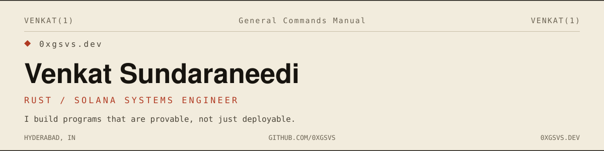

  

Rust and Solana systems engineer.

Hyderabad, India · [0xgsvs.dev](https://0xgsvs.dev) · [venkat.subrahmanyam.34@gmail.com](mailto:venkat.subrahmanyam.34@gmail.com)

---

## NAME

`venkat` — Rust, Solana programs, and the tooling that proves them.

## DESCRIPTION

I work close to the constraint: Rust programs, the Solana runtime, Anchor accounts and invariants, LiteSVM tests, and the terminal tools that keep the loop short. The default is to make the invariant explicit, test it until it is boring, then make the next one.

Completed **Turbin3**, where I shipped **Trana Protocol** to devnet. Currently in the **Rektoff** Solana security cohort.

## WORK

| Ship | What it is | State |
| --- | --- | --- |
| [Trana Protocol](https://github.com/0xgsvs/Trana_Protocol) | Parametric freight-delay indemnity on Solana. USDC pools, permissionless settlement, fully collateralised. | devnet · 38 LiteSVM tests |
| [solana-guard](https://github.com/0xgsvs/solana-guard) | Static analyzer for Anchor and native Solana programs. Six account-validation rules, text / JSON / SARIF. | MVP |
| [svm-fuzz](https://github.com/0xgsvs/svm-fuzz) | Invariant fuzzer on LiteSVM. Seeded sequences, shrinking, deterministic replay. | MVP |
| [svm-range](https://github.com/0xgsvs/svm-range) | Vulnerable Solana programs with working exploits, patches, and write-ups. | MVP |
| [pgjobq](https://github.com/0xgsvs/pgjobq) | Postgres job queue. `SKIP LOCKED`, retries, dead-letter queue, cron. | MVP |

## NOW

- Rektoff Solana security cohort, Oct 2026 —
- Building Token-2022, Metaplex, and Pinocchio projects; preparing a Trana Protocol audit write-up
- Maintaining Solana tooling in [nixpkgs](https://github.com/NixOS/nixpkgs/pulls?q=is%3Apr+author%3A0xgsvs)

## ELSEWHERE

[0xgsvs.dev](https://0xgsvs.dev) · [Writing](https://0xgsvs.dev/writing) · [Tools](https://0xgsvs.dev/tools) · [Contact](https://0xgsvs.dev/contact)
